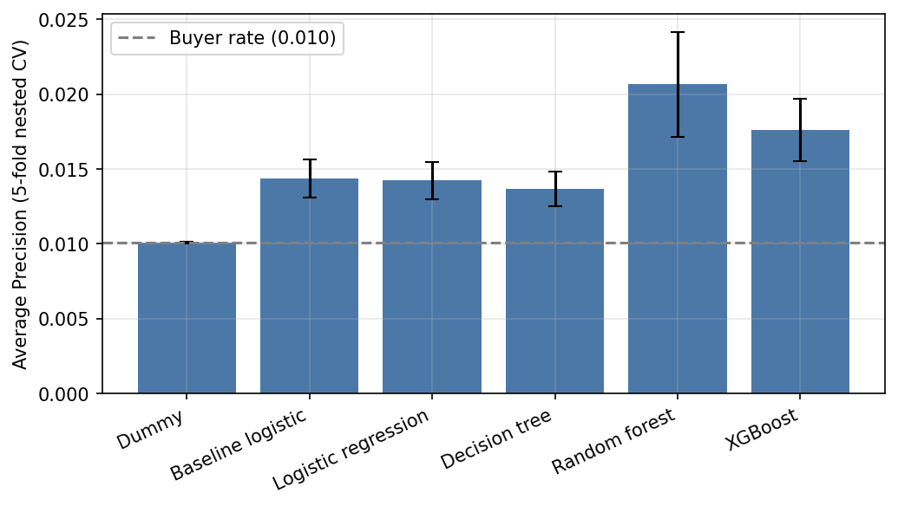
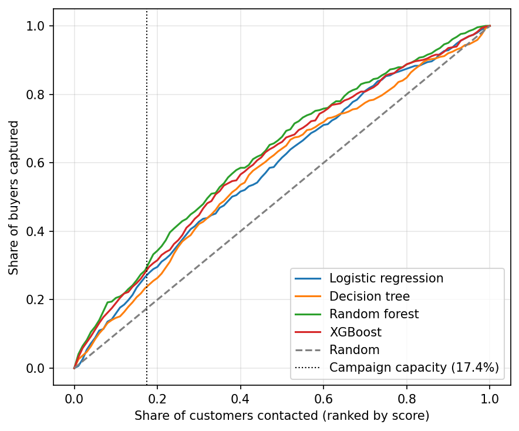
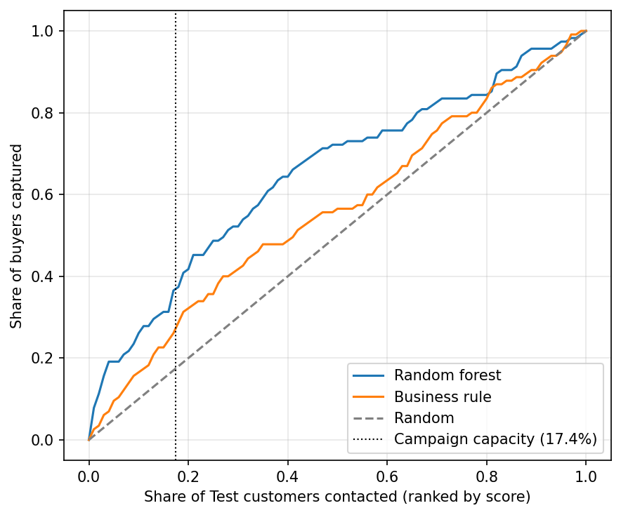
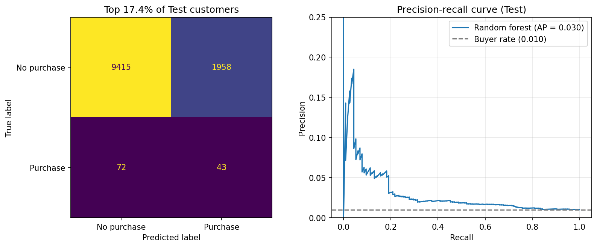

# Hillstrom Email Campaign: Customer Purchase Prediction

## Project Overview

This project follows the [StudyBuild Project 02 brief](StudyBuild-02Projectt.pdf). It explores the Hillstrom MineThatData email campaign data and builds a model to rank records by their likelihood of purchase before a campaign.

The business decision is how to prioritize a limited email list. The project studies whether customer records with higher model scores contain more observed buyers than a random list. It does not estimate which customers bought because they received an email.

**Current status:** Data preparation, exploratory analysis, model comparison, holdout evaluation, ranking analysis, a business-rule comparison, and initial interpretation are documented. The advanced spend-prediction stage remains outstanding. The [one-page executive summary](executive_summary.pdf) exists and needs a final consistency check against the saved notebook results. See [PDF Coverage and Remaining Work](#pdf-coverage-and-remaining-work).

## Business Question and Scope

The main question is: **Before a campaign, which customer records should be prioritized when the campaign can contact only a limited share of the base?**

The modeling notebook uses these pre-campaign inputs:

- `recency`: months since the last purchase
- `history`: prior-year spend
- `mens` and `womens`: indicators of previous purchases in those product categories; they do not represent customer gender
- `newbie`: customer status indicator
- `zip_code`: location group
- `channel`: prior purchase channel

The target is `conversion` (`1` = purchased, `0` = did not purchase). The notebook excludes `visit` and `spend` because they are measured after the campaign. It also excludes `segment` from the operational ranking model: campaign assignment is known only after the targeting decision in this scenario. The separate campaign-assignment analysis is diagnostic and does not estimate causal impact.

## Dataset

The source is the [Hillstrom MineThatData Email Analytics and Data Mining Challenge](https://blog.minethatdata.com/2008/03/minethatdata-e-mail-analytics-and-data.html).

The raw file contains 64,000 rows and 12 source columns. The cleaning notebook adds the audit field `is_exact_repeat_after_first`, giving 13 columns in the cleaned CSV. The file has no unique customer identifier, so all counts and lists are row-based; records cannot be confirmed as unique people.

The cleaned master file retains all 64,000 rows. For modeling, the 6,562 rows flagged as exact repeats after their first occurrence are excluded, leaving 57,438 rows and 578 buyers (1.01%). All 6,562 excluded rows were non-buyers, so the modeling population's buyer rate is higher than the original 0.90%. This is a modeling decision under uncertainty, not proof that the flagged rows represent duplicate people.

## Project Journey

### 1. Data Preparation

[`01_data_preparation.ipynb`](Notebooks/01_data_preparation.ipynb) checks the raw data, applies the agreed cleaning decisions, and saves `Data-raw/Cleaned/hillstrom_customers_cleaned.csv` without modifying the raw source.

- No missing values or blank text values were found.
- Binary fields contain only 0 and 1; recency is within 1-12 months; amount fields are non-negative.
- The provided `history_segment` labels match the numeric `history` ranges.
- Conversion outcomes are internally consistent: every conversion has a visit and positive spend, and no non-conversion has positive spend.
- The ZIP label `Surburban` was corrected to `Suburban` in the cleaned copy.
- Exact repeated rows were flagged after the first occurrence. The rows remain in the cleaned master file because no customer ID is available; the modeling notebook excludes the flagged rows and reports the decision.
- Plausible extreme values were retained. The IQR rule flags 3,593 `history` values. Across all rows it flags every positive `spend` value because 75% of spend is zero. Among positive spenders, 39 values exceed USD 334.97 and 12 rows equal USD 499; whether USD 499 is a cap is unverified.
- In-memory type optimization reduced the cleaning notebook's reported usage from about 8.09 MB to 1.65 MB. CSV files do not preserve pandas category types, so types are inferred again when loaded.

### 2. Exploratory Data Analysis

[`02_target_analysis.ipynb`](Notebooks/02_target_analysis.ipynb) describes the cleaned data and its observed associations. It includes eight charts covering class balance, numerical distributions, spend, categorical distributions, group conversion rates, and correlations.

- The original cleaned data has 578 buyers among 64,000 rows (0.90%) and 63,422 non-buyers (99.10%). An always-negative rule is 99.10% accurate but finds no buyers.
- `history` is right-skewed: mean USD 242.09, median USD 158.11, and maximum USD 3,345.93. `recency` has a mean of 5.76 months and median of 6.
- Spend is zero in 99.10% of rows. The 578 positive-spend rows match the 578 conversions, making `spend` a post-campaign outcome and an invalid input for pre-campaign prediction.
- Recency months 1-3 have a combined observed conversion rate of 1.24%, compared with 0.90% overall. Rates are not steadily decreasing across every month.
- The `$1,000+` history band has the highest observed rate (2.14%, 28 of 1,308 rows). Multichannel records have a 1.26% rate; Phone 0.77%; Web 0.93%.
- Campaign-group rates are 1.25% for Mens E-Mail, 0.88% for Womens E-Mail, and 0.57% for No E-Mail. These are descriptive rates; they do not by themselves prove campaign effects.
- The negative correlation between `mens` and `womens` is an association. Those fields represent past product purchases and can both equal 1.

These are row-level observations from one dataset and campaign period. They are not causal claims or guarantees about future campaigns.

### 3. Modeling Design and Leakage Checks

[`03_modeling.ipynb`](Notebooks/03_modeling.ipynb) uses a pre-campaign prediction scenario. The final Test rows are selected from rows not used in an earlier exploratory validation/test split. Model selection and tuning are done on Train with nested stratified cross-validation; the final Test set is used for the frozen model's evaluation.

The split contains 45,950 Train rows with 463 buyers (1.01%) and 11,488 Test rows with 115 buyers (1.00%).

A cross-validated leakage demonstration compares the pre-campaign features with versions that add post-campaign outcomes:

| Feature set | ROC-AUC | Average Precision |
|---|---:|---:|
| Pre-campaign features | 0.5853 | 0.0144 |
| Pre-campaign features + `visit` | 0.9287 | 0.0746 |
| Pre-campaign features + `spend` | 1.0000 | 1.0000 |

The perfect score with `spend` occurs because positive spend matches conversion in this dataset. It is leakage, not a usable improvement.

### 4. Feature Engineering and Models

The preprocessing is kept inside a scikit-learn Pipeline so each training fold learns its transformations without using its validation fold. The model uses:

- `log1p` and scaling for the right-skewed `history` field
- scaling for `recency`
- one-hot encoding for `zip_code` and `channel`
- binary indicators as supplied
- no `history_segment`, because it is a binned copy of `history`
- no oversampling or SMOTE

An earlier raw-versus-log comparison was reported to have only a small effect on model performance. The saved notebook uses `log1p(history)`, but does not show the side-by-side metrics, so that finding still needs to be recorded for reproducibility.

The notebook includes a Dummy baseline, a default Logistic Regression reference, and the required Logistic Regression, Decision Tree, and Random Forest models. XGBoost is also included as an additional comparison. Hyperparameters are selected with inner 3-fold cross-validation and evaluated across outer 5-fold stratified folds, using Average Precision as the tuning metric.

### 5. Cross-Validation Results

The table below follows the saved cross-validation results table in the modeling notebook. Values are mean and standard deviation across outer folds.

| Model | Average Precision | ROC-AUC | Brier score |
|---|---:|---:|---:|
| Dummy | 0.0101 +/- 0.0001 | 0.5000 +/- 0.0000 | 0.0100 +/- 0.0001 |
| Baseline Logistic Regression | 0.0144 +/- 0.0013 | 0.5853 +/- 0.0224 | 0.0100 +/- 0.0000 |
| Tuned Logistic Regression | 0.0142 +/- 0.0013 | 0.5847 +/- 0.0216 | 0.0567 +/- 0.0935 |
| Decision Tree | 0.0136 +/- 0.0012 | 0.5790 +/- 0.0135 | 0.0100 +/- 0.0001 |
| Random Forest | 0.0207 +/- 0.0035 | 0.6247 +/- 0.0274 | 0.0100 +/- 0.0001 |
| XGBoost | 0.0176 +/- 0.0021 | 0.6090 +/- 0.0242 | 0.0100 +/- 0.0001 |

Random Forest has the highest mean Average Precision, but its fold-to-fold variability overlaps the XGBoost results. It is the selected model by the stated mean-AP rule, not a proven winner. The AP baseline is the buyer rate (about 0.010), so the cross-validation signal is present but modest. The Brier score is close to the constant-rate baseline, so the model scores are used for ranking rather than as precise purchase probabilities.

At the campaign capacity of about 17.4%, validation-fold ranking finds an average of about 28 buyers per fold with Random Forest (recall 0.298, Lift 1.71). The other models find about 22-27 buyers at this capacity.





### 6. Final Test Results and Targeting

The selected Random Forest configuration is `max_depth=4` and `min_samples_leaf=30`. On the held-out Test set it reports ROC-AUC 0.6517, Average Precision 0.0303, buyer-rate baseline 0.0100, and Brier score 0.0099. Test contains only 115 buyers, so its estimates are uncertain and are not directly comparable with the cross-validation averages.

The Test ranking results are:

| Test share contacted | Rows selected | Buyers found | Precision | Recall | Lift |
|---:|---:|---:|---:|---:|---:|
| Top 5% | 575 | 22 | 0.038 | 0.191 | 3.822 |
| Top 10% | 1,149 | 30 | 0.026 | 0.261 | 2.608 |
| Top 17.4% | 2,001 | 43 | 0.021 | 0.374 | 2.147 |
| Top 20% | 2,298 | 48 | 0.021 | 0.417 | 2.087 |
| Top 30% | 3,447 | 60 | 0.017 | 0.522 | 1.739 |

At the assumed campaign capacity, the top 17.4% of Test rows contains 43 of 115 buyers. Its 2.1% purchase rate is about 2.15 times the Test base rate, while about 98% of the selected rows do not convert. In this capacity-based confusion matrix, a false positive is a contacted non-buyer (1,958 rows) and a false negative is a buyer outside the list (72 rows). A false positive uses an email slot; a false negative misses an opportunity to contact a buyer. Neither outcome establishes whether the email itself caused a purchase. This is a ranking improvement, not an estimate of incremental email impact or profit.





The probability thresholds 0.30-0.70 select no Test rows because the fitted model scores stay below about 0.05. A threshold based on the top 17.4% of out-of-fold Train scores selects 15.0% of Test, not exactly the planned share. For a fixed email capacity, ranking and taking the top k is more practical than applying a fixed probability cutoff.

The current targeting table is an evaluation on the held-out Test subset: 2,001 Test rows at 17.4%, not a final 10,000-record list from all eligible rows. The displayed sample list is illustrative only. The dataset has no customer ID, so it cannot be used as a verified contact list.

### 7. Business Rule Comparison

A simple rule prioritizes records with a purchase in the last three months (`recency <= 3`) and history at or above the Train 75th percentile. At the same 17.4% Test capacity, the model finds 43 buyers (Lift 2.15) and the rule finds 32 (Lift 1.60). At 5%, the model finds 22 buyers and the rule 11. The model improves ranking over this rule in the saved Test results, though the small number of buyers makes the difference uncertain.

### 8. Explainability and Customer Segments

Permutation importance for the selected Random Forest gives the largest mean AP drop to `history` (0.0059, standard deviation 0.0048), followed by `recency` (0.0023, standard deviation 0.0019). Other features are close to zero. With only 463 Train buyers, these importance estimates are noisy.

The notebook also shows Logistic Regression coefficients and three individual Logistic Regression examples. These explain that model only; they are not explanations of the selected Random Forest. Coefficients, permutation importance, and group rates describe patterns in the fitted data and do not establish causes.

Customer value is approximated by whether `history` is above the Train median. Purchase score is defined by the top 20% of Test scores. The resulting groups have small buyer counts:

| Group | Test rows | Buyers | Observed conversion rate | Interpretation in notebook |
|---|---:|---:|---:|---|
| Priority (higher history, higher score) | 1,681 | 31 | 1.8% | Consider prioritizing |
| Growth (lower history, higher score) | 622 | 17 | 2.7% | Test low-cost offers |
| Retention (higher history, lower score) | 3,972 | 29 | 0.7% | Use low-cost contact |
| Low priority (lower history, lower score) | 5,213 | 38 | 0.7% | Lower priority for testing |

Here `history` is only a proxy for past customer value, not lifetime value. The group names are descriptive targeting hypotheses, not churn or retention predictions. Each group contains few buyers, so strategy differences should be tested before use.

### 9. Campaign Assignment and Causality

In a separate diagnostic, adding `segment` to a Logistic Regression changes cross-validated ROC-AUC from 0.5853 to 0.6137 and Average Precision from 0.0144 to 0.0171. This is an association with campaign assignment and purchase in this dataset. Because the target decision is made before campaign assignment, `segment` is excluded from the operational ranking model. Neither this comparison nor the purchase-propensity model estimates the causal effect of email. An A/B test or an uplift design is needed for that question.

## Project Challenges and Limitations

- **Rare target:** about 1% of modeling rows are buyers, so many metrics have high uncertainty and accuracy is misleading.
- **No customer ID:** exact repeats can be flagged, but true customer identity and deduplication cannot be confirmed. Results are row-level.
- **Small Test buyer count:** there are 115 buyers in Test; Lift and recall estimates can vary substantially.
- **Same source period:** the final Test avoids rows used in an earlier exploratory evaluation, but comes from the same dataset and period; it is not an external future-period validation.
- **Weak probabilities:** Brier score is close to the constant-rate baseline. Scores should be used for ranking, not interpreted as calibrated probabilities.
- **Unknown economics:** email costs and profit per purchase are unavailable, so false-positive and false-negative costs cannot be quantified.
- **No causal estimate:** purchase propensity does not identify who changed behavior because of email.
- **Possible spend cap:** the USD 499 values may be capped, but the source does not confirm this.
- **Limited feature signal:** `history` and `recency` carry most of the measured ranking signal, but their importance estimates are noisy.

## PDF Coverage and Remaining Work

The project addresses the main StudyBuild stages: data understanding, cleaning, class imbalance, leakage, stratified split, pipeline preprocessing, the required classifiers, cross-validation, Test evaluation, threshold and capacity analysis, top-k Lift and gain, a business-rule comparison, feature interpretation, customer segmentation, campaign-assignment caveats, limitations, and an initial recommendation.

The following items remain before the full requested handoff is complete:

1. Add the required two-stage advanced spend prediction and estimate expected customer revenue.
2. Produce a final 10,000-row ranking after freezing the modeling approach. The current Test example selects 2,001 Test rows; the lack of customer IDs means this remains a row-level illustration, not an operational contact list.
3. Add a customer-level explanation for the selected Random Forest if the explainability section is intended to describe the final model; current individual examples explain Logistic Regression.
4. Complete the exact PDF metric checklist: report Accuracy for context, plus Precision, Recall, F1, and confusion matrices for the required models at a clearly stated operating point. The current report emphasizes ranking metrics and capacity-based results; Accuracy should not be used to select the model.
5. Reconcile the existing one-page executive summary PDF with the saved cross-validation table. The PDF reports XGBoost AP 0.0187, while the notebook table reports 0.0176; use the verified result before final delivery.
6. Consider uplift modeling as the optional bonus, after the required work is complete.
7. Reconcile the saved modeling notebook's written XGBoost cross-validation summary with its displayed table. This README follows the displayed table values: AP 0.0176 +/- 0.0021 and ROC-AUC 0.6090 +/- 0.0242.
8. Review the unreferenced older images in the figures directory before release. This README links only figures saved by the current modeling notebook; `confusion_matrix_test.png` is a legacy chart and does not show the current top-k Test confusion matrix.

## Repository Structure

```text
Project02-Customer-ML/
├── Data-raw/
│   ├── raw/                         # Original source CSV
│   └── Cleaned/                     # Cleaned master CSV with audit flag
├── Notebooks/
│   ├── 01_data_preparation.ipynb
│   ├── 02_target_analysis.ipynb
│   └── 03_modeling.ipynb
├── figures/                         # Saved modeling charts
├── StudyBuild-02Projectt.pdf        # Project brief
├── README.md
└── executive_summary.pdf            # One-page summary; reconcile XGBoost CV value
```

The modeling notebook also contains saved figure outputs. Saved charts referenced above are under `figures/`.

## Reproducing the Analysis

Open Jupyter with `Notebooks` as the working directory. The notebooks read the cleaned file through a relative path. The modeling notebook writes figures to `../figures/`.

Required libraries include pandas, NumPy, scikit-learn, Matplotlib, Seaborn, and XGBoost. The saved outputs in the notebooks are included for review; this README update did not execute any notebook cells.
